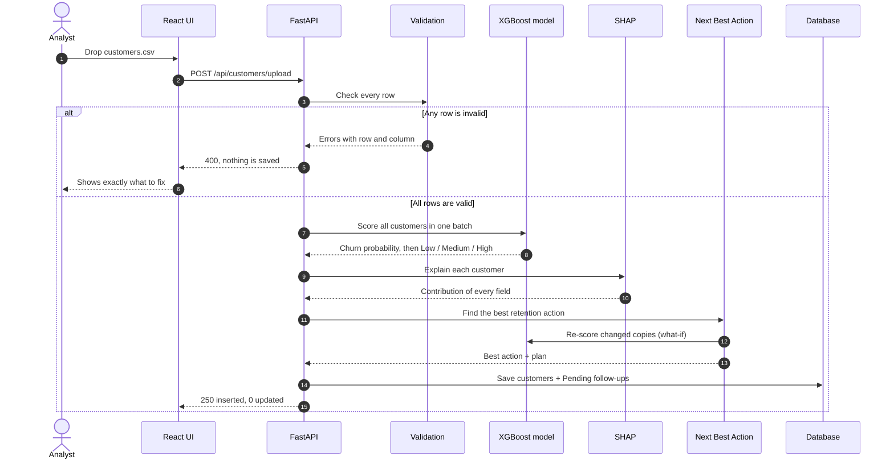
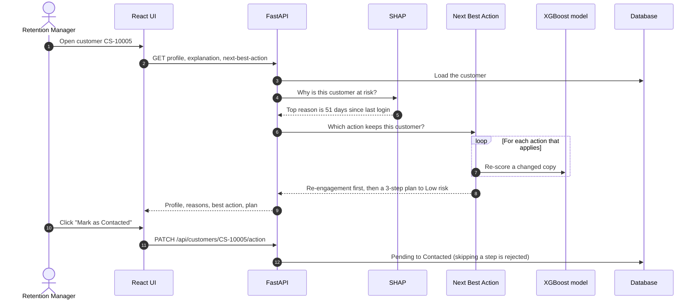

<div align="center">

# 📉 ChurnSense

### Explainable Customer Churn Prediction: **Predict · Explain · Act**

[](https://github.com/Shiva-Preetham/Agile-PBL/actions/workflows/ci.yml)


[](https://churnsense-one.vercel.app)

*Agile PBL project for **Fundamentals of Agile Software Development Lab (26B16CS314)**, JIIT Noida*

</div>

---

## 💡 What is ChurnSense? (in one minute)

Companies lose money when customers quietly leave ("churn"). ChurnSense helps an analyst:

| Step | What happens | Example |
|---|---|---|
| 1️⃣ **Upload** | Load customer data from a CSV; bad rows are rejected with clear messages | `Row 3: 'tenure_months' must be a whole number (got 'abc')` |
| 2️⃣ **Predict** | An XGBoost model gives every customer a churn probability | `CS-10042 → 87%` |
| 3️⃣ **Classify** | The probability becomes a risk level | 🟢 Low < 40% ≤ 🟠 Medium < 70% ≤ 🔴 High |
| 4️⃣ **Explain** | SHAP shows *why*: the top factors behind the prediction | "Month-to-month contract **increases** risk" |
| 5️⃣ **Act** | **Next Best Action**: every retention action is tried on a copy of the customer and re-scored; the one that lowers churn most wins, followed by a step-by-step plan to Low risk | "Re-engagement campaign: 98% → 83%. Plan: 3 actions → 39% (Low)" |
| 6️⃣ **Track** | Follow-up moves Pending → Contacted → Completed on a dashboard | |

> A raw score says *who* may leave. ChurnSense also says **why**, **what to do next**, and **how much it should help**. Every suggestion is reviewed by a human.

---

## 🌐 Live demo

| | Link |
|---|---|
| 🖥️ **App** (Vercel) | **https://churnsense-one.vercel.app** |
| ⚙️ **API docs** (Render) | https://churnsense-api-bz3x.onrender.com/docs |

No installation needed. The demo opens with 250 sample customers already loaded.
The free server sleeps when idle, so the **first visit can take about a minute**; a banner explains this while it wakes up.
How it is deployed (and how to redeploy): [docs/DEPLOYMENT.md](docs/DEPLOYMENT.md).

---

## 🧭 Agile at the heart of the project

The course is about **how** software is built. Every syllabus module has evidence in this repo:

| # | Syllabus module | Evidence in this repository |
|---|---|---|
| 1 | Waterfall vs Agile | [docs/agile/01_waterfall_vs_agile.md](docs/agile/01_waterfall_vs_agile.md): same project planned both ways, with a risk comparison |
| 2 | Agile Manifesto & User Stories | [docs/agile/02_product_backlog.md](docs/agile/02_product_backlog.md): 13 user stories, MoSCoW, INVEST, acceptance criteria |
| 3 | Scrum Framework | [docs/agile/03_scrum_framework.md](docs/agile/03_scrum_framework.md): roles, sprint goals, Definition of Done, stand-up |
| 4 | Estimation & Sprint Monitoring | [docs/agile/04_estimation_and_burndown.md](docs/agile/04_estimation_and_burndown.md): planning poker, capacity, velocity, burndown |
| 5 | XP Practices | [docs/agile/05_xp_practices.md](docs/agile/05_xp_practices.md): incremental sprints, a SHAP *spike*, CI, pair programming |
| 6 | Kanban & Crystal | [docs/agile/06_kanban_and_crystal.md](docs/agile/06_kanban_and_crystal.md): board with WIP limits, flow metrics, Crystal Clear D6 |
| 7 | Agile Testing & TDD | [docs/agile/07_testing_tdd.md](docs/agile/07_testing_tdd.md): tests committed **before** code each sprint, 142 tests, acceptance + exploratory testing, CI |
| 8 | Refactoring | [docs/agile/08_refactoring_and_retro.md](docs/agile/08_refactoring_and_retro.md): 5 real code smells found, 1 fixed with before/after, retrospective |

### 🔴🟢 TDD you can see in the git history

```text
test(S1): add failing tests for CSV validation, search and profile          [TDD RED]
feat(S1): CSV validation, customer storage, search & profile API            [TDD GREEN]
test(S2): add failing tests for risk thresholds, churn prediction, metrics  [TDD RED]
feat(S2): XGBoost churn model, risk categories and holdout metrics          [TDD GREEN]
test(S3): add failing tests for SHAP, retention rules, status, dashboard    [TDD RED]
feat(S3): SHAP explanations, retention actions, status tracking, dashboard  [TDD GREEN]
```

### 📦 Sprint progress

| Sprint | Goal | Stories | SP | Status |
|---|---|---|---|---|
| S1 Foundation | Customer data workflow | US01–US03 | 11 | ✅ in prototype |
| S2 Prediction | Churn prediction MVP | US04–US06 | 10 | ✅ in prototype |
| S3 Decision Support | Explainable decisions | US07–US10 | 14 | ✅ in prototype |
| S4 Quality & Release | Tested, refactored, hosted release + Next Best Action | US11–US15 | 19 | 🟡 tests, CI, US14 and live deployment done; 1 of 5 smells refactored, rest after feedback |

---

## 🏗️ Architecture

<p align="center">
  
</p>

### How to read the diagram

| # | Layer | What happens there | Technology | Code |
|---|---|---|---|---|
| 1 | 👥 **Users** | An *Analyst* uploads and explores data; a *Retention Manager* acts on suggestions | Browser | — |
| 2 | 🖥️ **Frontend** | Four screens: Dashboard, Customers, Customer detail, Model | React 18, TypeScript, Vite, Recharts | `frontend/src` |
| 3 | ⚙️ **Backend API** | Receives every request and runs the **6-step service pipeline** for each customer | FastAPI, Python 3.11, Pydantic | `backend/app` |
| 4 | 🗄️ **Data** | Stores customers, predictions and follow-up actions; holds the trained model files | SQLAlchemy 2 (SQLite → PostgreSQL) | `backend/app/models.py`, `backend/models/` |
| 5 | 🧪 **Offline ML pipeline** | Generates the training data, trains XGBoost once, records honest holdout scores | pandas, scikit-learn, XGBoost, SHAP | `backend/ml/` |
| 6 | ✅ **Quality & delivery** | Every push runs style checks, 142 tests on SQLite **and** PostgreSQL, and the frontend build; Render deploys only when all are green | Pytest, flake8, GitHub Actions, Render, Vercel | `.github/workflows/ci.yml`, `render.yaml` |

**The service pipeline in one line:** ① check the data → ② predict churn → ③ label the risk → ④ explain *why* → ⑤ pick the action that helps most → ⑥ track the follow-up.

### What happens when an analyst uploads a CSV



### What happens when a manager opens a customer



### Tech stack

| Layer | Technology |
|---|---|
| Frontend | React 18, TypeScript, Vite, Recharts |
| Backend / API | Python 3.11, FastAPI, Pydantic, SQLAlchemy 2 |
| Database | PostgreSQL on Render (hosted demo) · SQLite for local development, chosen with `DATABASE_URL` |
| ML / XAI | Pandas, NumPy, scikit-learn, XGBoost, SHAP |
| Testing / Quality | Pytest (unit + API), flake8, TypeScript strict mode |
| Version control / CI / CD | Git, GitHub, GitHub Actions → auto-deploy to Render (backend) and Vercel (frontend) |

---

## 🚀 Run it locally

**Backend** (terminal 1):

```bash
cd backend
python -m venv .venv
.venv\Scripts\activate          # Windows  (macOS/Linux: source .venv/bin/activate)
pip install -r requirements.txt
uvicorn app.main:app --reload
```

The API runs at http://localhost:8000 and interactive API docs are at http://localhost:8000/docs.

**Frontend** (terminal 2):

```bash
cd frontend
npm install
npm run dev
```

Open http://localhost:5173, go to **Customers**, and upload `backend/data/sample_customers.csv`.
Try `sample_invalid_rows.csv` to see validation errors.

**Run the tests:**

```bash
cd backend
python -m pytest
```

**Re-create the data and retrain the model (optional):**

```bash
cd backend
python -m ml.generate_data
python -m ml.train
```

---

## 📊 Model quality (holdout set, never seen in training)

| ROC-AUC | Accuracy | Precision | Recall | F1 |
|---|---|---|---|---|
| **0.829** | 0.763 | 0.628 | 0.539 | 0.580 |

Trained on 2,400 customers and tested on 600 held-out customers. Training-set scores are stored separately and used only to check for overfitting. The dataset is **synthetic** (reproducible, no private data); SHAP's top factors (contract type, monthly charges, tenure) match how the data was designed, which shows the explanations are trustworthy.

---

## 📁 Project structure

```text
├── backend/
│   ├── app/
│   │   ├── routers/        # REST endpoints (customers, model, dashboard)
│   │   ├── services/       # validation, prediction, risk, explain, recommend, next_best_action, actions, dashboard
│   │   ├── models.py       # database tables
│   │   └── main.py         # FastAPI app
│   ├── ml/                 # data generator + training script
│   ├── data/               # training data and sample CSVs
│   ├── models/             # trained model + metrics.json
│   └── tests/              # 142 pytest tests (written test-first)
├── frontend/src/           # React + TypeScript UI
├── docs/agile/             # Agile artifacts, one file per syllabus module
├── .github/workflows/      # CI: tests (SQLite + PostgreSQL) + style + frontend build
└── render.yaml             # Render Blueprint: backend + PostgreSQL
```

---

## 👥 Team

| Member | Scrum role | Development role |
|---|---|---|
| **Shiva Preetham Chelimila** (2401030078) | Product Owner | ML & Backend Developer |
| **Artham Kumar** (2401030064) | Scrum Master | Frontend & QA Developer |

**Faculty:** Dr. Indu Chawla

## 🔁 Next: feedback → backlog

This is **Prototype v0.1** for the first faculty review. The demo script and Q&A are in [docs/FACULTY_REVIEW_GUIDE.md](docs/FACULTY_REVIEW_GUIDE.md). Feedback from the review becomes new or updated backlog items for the next sprint: *inspect and adapt*.
