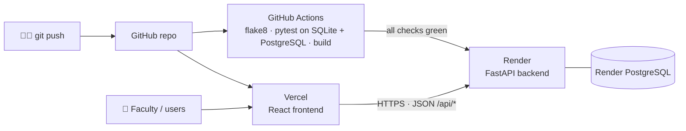

# Deploying ChurnSense (Render + Vercel)

> **User story US15:** *As a faculty reviewer, I want to open ChurnSense from a web link so that I can try it without installing anything or running servers.*

## How the hosted version fits together

| Part | Host | Plan | Live address |
|---|---|---|---|
| Frontend (React build) | **Vercel** (project `churnsense`) | Hobby (free) | https://churnsense-one.vercel.app |
| Backend API (FastAPI) | **Render** web service `churnsense-api` | Free | https://churnsense-api-bz3x.onrender.com (docs: `/docs`) |
| Database | **Render PostgreSQL** `churnsense-db` (PostgreSQL 18) | Free | internal to Render |

Everything is described in code: [`render.yaml`](../render.yaml) (Render Blueprint) and the `VITE_API_URL` setting for Vercel.

---

## Step 1: Backend on Render (about 10 minutes, mostly waiting)

1. Go to **render.com** and sign in with your **GitHub** account.
2. Click **New +** → **Blueprint**.
3. Connect the GitHub repository **Shiva-Preetham/Agile-PBL** (allow Render to read it).
4. Render reads `render.yaml` and shows **churnsense-api** (web service) and **churnsense-db** (PostgreSQL). Click **Apply** (or **Deploy Blueprint**).
5. Wait for the first build (installing XGBoost and SHAP takes a few minutes). On start-up the empty database is **filled automatically with the 250 demo customers**.
6. Copy the service address from the Render dashboard, e.g. `https://churnsense-api.onrender.com`.
7. Check it works:
   - `https://<your-render-address>/api/health` should show `{"status":"ok", ...}`
   - `https://<your-render-address>/docs` shows the interactive API documentation

> If Render added a suffix to the name (e.g. `churnsense-api-x1y2.onrender.com`), use that exact address in Step 2.

## Step 2: Frontend on Vercel (about 3 minutes)

1. Go to **vercel.com** and sign in with your **GitHub** account.
2. Click **Add New…** → **Project** and **Import** the **Agile-PBL** repository.
3. **Root Directory:** click *Edit* and choose **`frontend`**. Vercel detects **Vite** automatically (build `npm run build`, output `dist`).
4. **Environment Variables:** add
   - Name: `VITE_API_URL`
   - Value: your Render address from Step 1, **without** a trailing slash (e.g. `https://churnsense-api.onrender.com`)
5. Click **Deploy**. You get an address like `https://agile-pbl.vercel.app`.

## Step 3: Check the live app

1. Open the Vercel address. If the backend was asleep you'll see **"Waking up the server…"** for up to a minute. That's normal on the free plan.
2. The Dashboard shows **250 customers**. Open the top customer to check the SHAP chart, the Next Best Action and "Mark as Contacted".
3. Put both links in the README's **Live demo** section.

---

## How updates are released (continuous delivery)

| You do | What happens automatically |
|---|---|
| `git push` to `main` | GitHub Actions runs flake8, all tests on SQLite **and** PostgreSQL, and the frontend build |
| CI is green ✅ | Render redeploys the backend (`autoDeployTrigger: checksPass`) |
| CI is red ❌ | Render does **not** deploy, so the live demo keeps the last working version |
| Any push | Vercel rebuilds the frontend (branches get their own preview link) |

## Free-plan limits and what to do about them

| Limit | Effect | What to do |
|---|---|---|
| Backend **sleeps after 15 minutes** without visitors | First request takes about a minute | Open the site **2 minutes before a demo**. The app shows a "waking up" banner meanwhile. |
| Free PostgreSQL **expires 30 days after creation** (14-day grace period) | The API can't reach its database | In Render, delete **churnsense-db**, then open the Blueprint and click **Sync**. A new database is created and demo data is loaded again (status changes from before are lost). |
| 512 MB memory | — | ChurnSense peaks at about 340 MB (measured) |
| `VITE_API_URL` is read **at build time** | Changing it does nothing until the next build | After changing it in Vercel, click **Redeploy** |

## Configuration reference

**Backend (Render → churnsense-api → Environment)**

| Variable | Default | Purpose |
|---|---|---|
| `DATABASE_URL` | local SQLite file | Set by the Blueprint to the Render PostgreSQL connection string |
| `SEED_DEMO_DATA` | `false` (`true` on Render) | Load the 250 sample customers into an **empty** database on start-up |
| `PYTHON_VERSION` | `3.11.9` | Same Python as development and CI |
| `CORS_ORIGINS` | `http://localhost:5173,http://127.0.0.1:5173` | Extra exact websites allowed to call the API (e.g. a custom domain) |
| `CORS_ORIGIN_REGEX` | `https://[a-z0-9-]+\.vercel\.app` | Allows the Vercel production and preview addresses |

**Frontend (Vercel → Project → Settings → Environment Variables)**

| Variable | Purpose |
|---|---|
| `VITE_API_URL` | Address of the Render backend. Leave empty locally; Vite forwards `/api` to `localhost:8000`. |

## Troubleshooting

| Symptom | Likely cause | Fix |
|---|---|---|
| "Cannot reach the ChurnSense API at …" | Wrong or missing `VITE_API_URL`, or the backend is still starting | Check the address, wait a minute, then **Redeploy** on Vercel if you changed it |
| Browser console shows a CORS error | Frontend served from a domain that isn't allowed | Add it to `CORS_ORIGINS` on Render |
| Render build fails while installing packages | Wrong Python version | Make sure `PYTHON_VERSION` is `3.11.9` |
| Render didn't deploy after a push | CI failed (by design) | Fix the failing check on GitHub, then push again |
