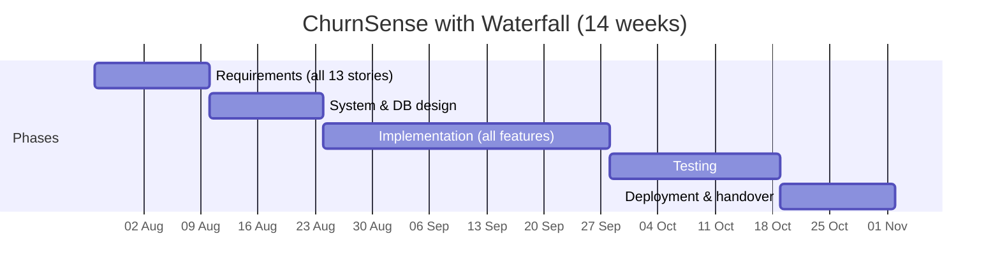
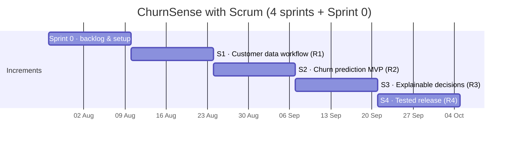

# Module 1 — Waterfall vs Agile: Comparative Study for ChurnSense

> **Syllabus link:** Module 1, *Introduction to Agile — Comparative Study* (CO1)
> We planned the **same application (ChurnSense)** twice, once with Waterfall and once with Agile, and compared timelines, deliverables and risk handling.

---

## 1. Plan A — Waterfall (one long sequence)

Each phase must finish completely before the next one starts. The customer sees working software only at the very end.

| Phase | Weeks | Deliverable |
|---|---|---|
| Requirements | 1–2 | Full Software Requirements Specification (SRS) |
| Design | 3–4 | Architecture, DB schema, UI mock-ups |
| Implementation | 5–9 | All modules coded together |
| Testing | 10–12 | Test report (bugs found late) |
| Deployment | 13–14 | Final system, the **first** time anyone can use it |

## 2. Plan B — Agile / Scrum (four short cycles)

Each 2-week sprint goes through plan → build → test → review → retrospective and ends with a **working increment** we can demo.

| Sprint | Story points | Working increment shown at Sprint Review |
|---|---|---|
| S1 Foundation | 11 | R1: upload & validate CSV, search, customer profile |
| S2 Prediction | 10 | R2: churn probability, Low/Medium/High risk, model metrics |
| S3 Decision Support | 14 | R3: SHAP explanations, retention actions, dashboard |
| S4 Quality & Release | 11 | R4: regression tests, refactoring, CI, documentation |

## 3. Side-by-side comparison

| Criterion | Waterfall | Agile (Scrum + Kanban) |
|---|---|---|
| **First usable software** | Week 13–14 | End of Sprint 1 (about week 4) |
| **Feedback from faculty / users** | Once, at the end | At every Sprint Review (4+ times) |
| **Changing requirements** | Expensive: needs a change request and re-design | Cheap: add or re-prioritize in the Product Backlog |
| **Testing** | One phase near the end | Continuous: TDD and CI on every push |
| **Main deliverables** | SRS, design document, final system | Product backlog, sprint increments, burndown, test reports |
| **Progress visibility** | "% of phase complete" (hard to verify) | Burndown chart, Kanban board, working demo |
| **Team roles** | Analyst, designer, developer, tester in sequence | Product Owner, Scrum Master, cross-functional developers |

## 4. Risk handling for ChurnSense

| Risk | What happens with Waterfall | How Agile handles it |
|---|---|---|
| ML model accuracy is poor | Found during testing in week 10+, too late to change approach | Model metrics are shown in Sprint 2 review, so we can change features or the model early |
| SHAP explanations confuse users | Discovered at handover | Faculty feedback at the S3 review goes straight into the backlog |
| Bad CSV data crashes the system | Integration bugs pile up at the end | Validation is built and tested first (S1), with TDD |
| Team member unavailable | Phase is blocked | Pair programming spreads knowledge; WIP limits keep work small |
| Scope too large for 14 weeks | Everything is late together | Backlog is ordered by priority, so low-priority stories can be dropped and the core still ships |

## 5. Conclusion

ChurnSense has **uncertain parts** (model quality, how understandable the explanations are), so early feedback matters. Waterfall would hide those risks until the end. **Agile lets us show a working prototype now, collect feedback, and improve sprint by sprint**, which is exactly why this repository has a *Prototype v0.1* for faculty review.
