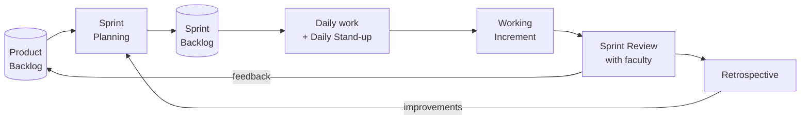

# Module 3 — Scrum Framework Implementation

> **Syllabus link:** Module 3, *Scrum Framework Implementation* (CO2)

## Scrum team

| Member | Scrum role | Development role |
|---|---|---|
| **Shiva Preetham Chelimila** (2401030078) | Product Owner | ML & Backend Developer (data validation, model, SHAP, APIs) |
| **Artham Kumar** (2401030064) | Scrum Master | Frontend & QA Developer (dashboard UI, testing, CI) |

Both members are also **Developers** in the Scrum sense: anyone can pick any task.

## Scrum events we run



| Event | When | Time-box | Output |
|---|---|---|---|
| Backlog refinement | Mid-sprint | 30 min | Stories split, acceptance criteria clarified, estimates updated |
| Sprint Planning | Day 1 of sprint | 1 hour | Sprint goal + sprint backlog |
| Daily Stand-up | Every lab / working day | 10 min | Three questions answered, blockers raised |
| Sprint Review | Last day | 30 min | Demo to faculty, feedback added to backlog |
| Retrospective | After review | 30 min | One or two concrete improvement actions |

## Sprint goals

| Sprint | Sprint goal | Stories | SP | Increment |
|---|---|---|---|---|
| **S1 Foundation** | "An analyst can load customer data safely and browse it." | US01, US02, US03 | 11 | R1 Customer data workflow |
| **S2 Prediction** | "Every customer gets a churn probability and a risk category." | US04, US05, US06 | 10 | R2 Churn prediction MVP |
| **S3 Decision Support** | "Managers understand *why* and know *what to do next*." | US07, US08, US09, US10 | 14 | R3 Explainable decisions |
| **S4 Quality & Release** | "A tested, refactored, CI-checked release." | US11, US12, US13 | 11 | R4 Tested release |

## Definition of Done (DoD)

A story is **Done** only when:

- [x] All acceptance criteria are met
- [x] Relevant automated tests are written and pass
- [x] Code is reviewed (pull request or pair review) and merged to `main`
- [x] CI is green
- [x] Documentation is updated
- [x] Feature is demonstrated at the Sprint Review

## Daily Stand-up template (role-play)

```text
Date: ____   Sprint: __   Day: __ / 10
Shiva   - Yesterday: ______  Today: ______  Blockers: ______
Artham  - Yesterday: ______  Today: ______  Blockers: ______
Scrum Master notes / actions: ______
```

*Example (role-play during Sprint 1):*

> **Shiva:** Yesterday I wrote failing tests for CSV validation. Today I'll make them pass. No blockers.
> **Artham:** Yesterday I set up the React project. Today I'll build the upload screen. Blocker: I need the API error format, so we'll pair for 15 minutes after the stand-up.

## Sprint Review: Prototype v0.1 (current)

| Item | Detail |
|---|---|
| Increment shown | Prototype v0.1: working end-to-end slice of S1–S3 features |
| Audience | Lab faculty |
| Demo script | See [../FACULTY_REVIEW_GUIDE.md](../FACULTY_REVIEW_GUIDE.md) |
| Feedback received | *To be filled in during the review* |
| Backlog changes | *New or updated stories from the feedback* |
