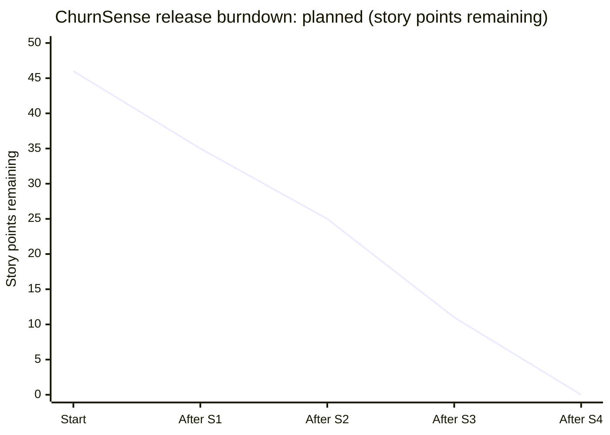

# Module 4 — Agile Estimation & Sprint Monitoring

> **Syllabus link:** Module 4, *Agile Estimation & Sprint Monitoring* (CO2)

## 1. Planning Poker

We estimate **relative size** (effort + complexity + uncertainty), not hours, using a free online planning-poker tool and the Fibonacci deck **1, 2, 3, 5, 8, 13**.

**Steps for each story**

1. The Product Owner reads the story and its acceptance criteria.
2. Each developer picks a card in secret.
3. Everyone reveals at the same time.
4. If the numbers differ, the highest and lowest voters explain their reasoning.
5. Re-vote until the team agrees.

**Reference story:** US05 (risk category) = **2 SP**, because it's a small, well-understood rule. Other stories are sized relative to it.

| Story | Why this size | Estimate |
|---|---|---|
| US01 CSV upload & validation | Many error cases (missing columns, bad rows, duplicates) | 5 |
| US02 Search & filter | Simple query plus an empty state | 3 |
| US03 Customer profile | Read-only view plus a not-found case | 3 |
| US04 Churn probability | Model training, saving and inference | 5 |
| US05 Risk category | Threshold rule (**reference story**) | 2 |
| US06 Model metrics | Holdout split and four metrics | 3 |
| US07 SHAP explanation | New library; mapping one-hot features back to readable names | 5 |
| US08 Retention action | Rule table plus fallback | 3 |
| US09 Action status | State transitions plus persistence | 3 |
| US10 Dashboard | Aggregations plus charts | 3 |
| US11 Automated tests | Unit + API tests across modules | 5 |
| US12 Refactoring | Identify and fix smells safely | 3 |
| US13 CI | GitHub Actions workflow | 3 |
| **Total** | | **46** |

## 2. Team capacity

| Item | Value |
|---|---|
| Team members | 2 |
| Sprint length | 2 weeks (10 working days) |
| Focus hours per person per sprint | about 12 h (lab + self-study; course has 30 notional hours) |
| Planned load | 10–14 SP per sprint |

## 3. Velocity

**Velocity = story points of stories that are fully *Done* in a sprint.** Partly finished stories count as 0.

| Sprint | Planned SP | Completed SP | Velocity |
|---|---|---|---|
| S1 | 11 | *fill after sprint* | |
| S2 | 10 | *fill after sprint* | |
| S3 | 14 | *fill after sprint* | |
| S4 | 11 | *fill after sprint* | |

Average velocity = (sum of completed SP) ÷ (number of sprints). We use it to forecast how much fits in the next sprint.

## 4. Release burndown (planned)

The ideal line drops by each sprint's planned story points: 46 → 35 → 25 → 11 → 0.

## 5. Sprint burndown template (10 days)

Fill in the remaining SP at the end of each day and compare it with the ideal line.

| Day | 0 | 1 | 2 | 3 | 4 | 5 | 6 | 7 | 8 | 9 | 10 |
|---|---|---|---|---|---|---|---|---|---|---|---|
| Ideal (S3, 14 SP) | 14 | 12.6 | 11.2 | 9.8 | 8.4 | 7 | 5.6 | 4.2 | 2.8 | 1.4 | 0 |
| Actual | | | | | | | | | | | |

**How to read it**

- Actual line **above** ideal → behind schedule. Discuss at the stand-up and drop or split scope.
- Actual line **below** ideal → ahead. Pull the next story from the backlog.
- **Flat** line → work is blocked, or stories are too big to finish.
