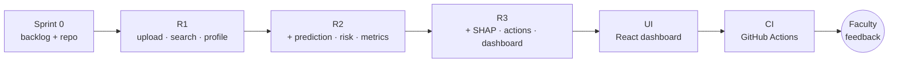
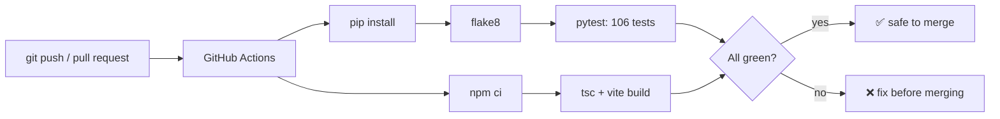

# Module 5 — Extreme Programming (XP) Practices

> **Syllabus link:** Module 5, *Extreme Programming (XP) Practices* (CO3)

## XP practices used in ChurnSense

| XP practice | How we apply it | Evidence |
|---|---|---|
| **Pair programming** | Driver writes code, navigator reviews and thinks ahead; switch every 25 minutes | Pairing log below; VS Code Live Share |
| **Test-first (TDD)** | Every sprint starts with failing tests | `[TDD RED]` → `[TDD GREEN]` commits ([07_testing_tdd.md](07_testing_tdd.md)) |
| **Small releases / incremental development** | Each sprint adds one working increment on top of the previous one | R1 → R2 → R3 in the commit history |
| **Continuous integration** | Every push runs tests, style checks and the frontend build | [.github/workflows/ci.yml](../../.github/workflows/ci.yml) |
| **Spike** | A short experiment to reduce risk before committing to a design | SHAP + XGBoost compatibility spike at the start of Sprint 3 |
| **Simple design (YAGNI)** | Build only what the current stories need | SQLite now, PostgreSQL later through one `DATABASE_URL` setting |
| **Refactoring** | Improve structure without changing behaviour; tests prove it | [08_refactoring_and_retro.md](08_refactoring_and_retro.md) |
| **Coding standard** | Shared style rules checked automatically | flake8 (`backend/.flake8`), TypeScript `strict` mode |
| **Collective code ownership** | Both members can change any file; reviews via pull requests | GitHub repository |

## Incremental development: how the product grew

Each increment was **working and tested** before the next one started. For example, Sprint 2 added prediction to the existing upload flow without breaking Sprint 1's 23 tests.

## The SHAP spike (Sprint 3)

**Question:** Does SHAP's `TreeExplainer` work with our XGBoost version, and do the explanations really match the model?

**Experiment (about 10 minutes):** Explain one risky and one loyal customer, then check that `base value + sum of SHAP values = model output (log-odds)`.

**Result:** `4.7429 ≈ 4.7429` and `-6.2239 ≈ -6.2239`, an exact match. This became an automated test (`test_contributions_add_up_to_the_model_output`).

## Pair programming (driver–navigator) with VS Code Live Share

1. The driver installs the **Live Share** extension and clicks *Share*. The navigator joins with the link.
2. **Driver:** types the code and focuses on the current line.
3. **Navigator:** reviews each line, spots bugs, and thinks about the next test and edge cases.
4. Swap roles every **25 minutes** (one Pomodoro).

### Pairing log (fill in during lab sessions)

| Date | Story / task | Driver | Navigator | Outcome / what we learned |
|---|---|---|---|---|
| | US01 CSV validation | | | |
| | US07 SHAP explanation | | | |
| | | | | |

## Continuous integration

