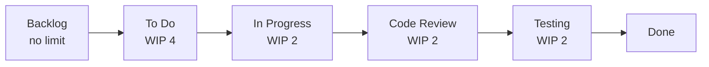

# Module 6 — Kanban & Crystal Methodology

> **Syllabus link:** Module 6, *Kanban & Crystal Methodology* (CO3)

## 1. Kanban board with WIP limits

We use the board on **GitHub Projects / Trello**. The columns follow our synopsis workflow:

| Column | WIP limit | Rule to enter the column |
|---|---|---|
| Backlog | none | Story written in "As a… I want… so that…" format |
| To Do | 4 | Story is estimated and selected for the sprint |
| In Progress | **2** (one per developer) | A developer (or pair) owns it; tests are written first |
| Code Review | 2 | Pull request opened; CI is green |
| Testing | 2 | Reviewed; acceptance criteria are being checked |
| Done | none | Meets the Definition of Done |

**Why WIP limits?** With two developers, more than two items "In Progress" means work is being started but not finished. The limit forces us to **finish before starting**, which shortens cycle time.

## 2. Flow metrics we track

| Metric | Definition | How we measure |
|---|---|---|
| **Cycle time** | Time from *In Progress* to *Done* | Card dates on the board |
| **Lead time** | Time from *Backlog* to *Done* | Card creation date → Done date |
| **Throughput** | Cards finished per week | Count of cards in Done |
| **WIP** | Cards currently in progress | Count of cards in the middle columns |

**Little's Law:** average cycle time ≈ average WIP ÷ throughput. Keeping WIP low keeps cycle time short.

### Cycle-time log (template)

| Card | Started | Done | Cycle time (days) |
|---|---|---|---|
| US01 CSV upload | | | |
| US05 Risk category | | | |
| … | | | |

## 3. Crystal methodology: where ChurnSense fits

Crystal chooses a process "weight" from **team size** (colour) and **criticality** (what a defect can cost).

| Criticality level | Meaning | ChurnSense? |
|---|---|---|
| C: Comfort | A defect causes loss of comfort | |
| **D: Discretionary money** | A defect may cost recoverable money | ✅ A wrong churn prediction could waste a retention offer, but the loss is recoverable |
| E: Essential money | A defect costs essential money | |
| L: Life | A defect could cost lives | |

- **Team size:** 2 people → **Crystal Clear** (for 1–6 people)
- **Category:** **D6** (Discretionary money, up to 6 people)

### Relating work-item complexity to Crystal

| Work item | Complexity | Crystal practice we apply |
|---|---|---|
| US05 Risk thresholds | Low | Frequent delivery; small, fully tested change |
| US01 CSV validation | Medium | Osmotic communication: we pair in the lab |
| US07 SHAP explanations | High (new library) | Personal safety: say "I don't understand SHAP yet" early; spike, then pair |
| US13 CI | Medium | Technical environment with automated tests and frequent integration |

**Crystal Clear properties we follow:** frequent delivery (2-week sprints), reflective improvement (retrospectives), osmotic communication (same lab, pairing), personal safety, focus (WIP limits), easy access to expert users (faculty reviews), and a technical environment with automated tests and CI.
