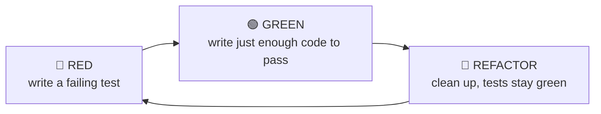

# Module 7 — Agile Testing & Test-Driven Development

> **Syllabus link:** Module 7, *Agile Testing & Test-Driven Development* (CO4)

## 1. The TDD cycle we follow



## 2. Proof in the git history

For every sprint, the tests were committed and pushed **before** the code that makes them pass:

| Sprint | RED commit (tests only, failing) | GREEN commit (implementation) | Result |
|---|---|---|---|
| S1 | `test(S1): … [TDD RED]`: `ModuleNotFoundError: app.database` | `feat(S1): … [TDD GREEN]` | 23 passed |
| S2 | `test(S2): … [TDD RED]`: 3 collection errors | `feat(S2): … [TDD GREEN]` | 54 passed |
| S3 | `test(S3): … [TDD RED]`: `No module named app.services.explain` | `feat(S3): … [TDD GREEN]` | 106 passed |
| S4 (started) | — | `refactor: extract _find_and_explain …` | 106 passed before **and** after |
| US14 | `test(US14): … [TDD RED]`: `cannot import name 'next_best_action'` | `feat(US14): … [TDD GREEN]` | 129 passed |

See the full [commit history](https://github.com/Shiva-Preetham/Agile-PBL/commits/main).

## 3. Test inventory (129 automated tests)

| Test file | Tests | Type | User stories |
|---|---|---|---|
| `test_validation.py` | 12 | Unit | US01 |
| `test_api_customers.py` | 11 | API / integration | US01, US02, US03 |
| `test_risk.py` | 16 | Unit (boundary values) | US05 |
| `test_prediction.py` | 6 | Unit | US04 |
| `test_api_prediction.py` | 9 | API / integration | US04, US05, US06 |
| `test_explain.py` | 8 | Unit | US07 |
| `test_recommend.py` | 17 | Unit | US08 |
| `test_actions.py` | 12 | Unit (state transitions) | US09 |
| `test_api_decisions.py` | 15 | API / integration | US07, US08, US09, US10 |
| `test_next_best_action.py` | 18 | Unit (properties of ranking and plan) | US14 |
| `test_api_next_best_action.py` | 5 | API / integration | US14 |

**Run them all with one command (US11):**

```bash
cd backend
python -m pytest -v
```

Every test uses a fresh **in-memory database**, so tests never depend on each other or on the real data file.

## 4. Testing techniques used

| Technique | Example |
|---|---|
| **Boundary value analysis** | Risk thresholds: 0.3999 → Low, **0.40 → Medium**, 0.6999 → Medium, **0.70 → High** |
| **Equivalence partitioning** | Valid CSV / missing columns / bad values / empty file / duplicates |
| **Negative testing** | Unknown status `"Done"` → 422; skipping a step (Pending → Completed) → 409 |
| **Property check** | Every probability from 0.000 to 1.000 maps to exactly one category |
| **Consistency check** | SHAP base value + contributions = model output |
| **Reproducibility** | Same input twice → identical probability |

## 5. Acceptance testing (manual, at Sprint Review)

| Story | Acceptance check | Result (Prototype v0.1) |
|---|---|---|
| US01 | Upload `sample_customers.csv` → 250 inserted; upload `sample_invalid_rows.csv` → 5 row-level errors, nothing saved | ✅ |
| US02 | Search "100" filters the table; a nonsense search shows "No matching customers" | ✅ |
| US03 | Clicking a customer shows all attributes and activity metrics | ✅ |
| US04/05 | Probability and risk badge are shown together; what-if form updates live | ✅ |
| US06 | Model page shows holdout metrics; training scores hidden under "overfitting check only" | ✅ |
| US07 | Detail page shows the top 5 SHAP factors for that customer | ✅ |
| US08 | Suggested step shows rule ID and "Needs human review" | ✅ |
| US09 | "Mark as Contacted" updates the stepper and persists after reload | ✅ |
| US10 | Dashboard counts match 250 customers; filters change counts; empty DB shows a friendly message | ✅ |

## 6. Exploratory testing log

| Date | Charter (what we explored) | Finding | Action |
|---|---|---|---|
| 2026-11-08 | Customer detail page with high-risk customers | The biggest SHAP factor appeared at the **bottom** of the chart, which reads backwards | Fixed in commit `fix(ui): show strongest SHAP factor at the top` |
| 2026-11-08 | Upload a broken CSV through the UI | Errors are shown per row; nothing is saved | No action needed |
| | | | |

## 7. Automation with GitHub Actions

Every push and pull request runs flake8, all 129 pytest tests, and the TypeScript type-check + production build. A failing step turns the run red and is visible on GitHub. See [.github/workflows/ci.yml](../../.github/workflows/ci.yml).
